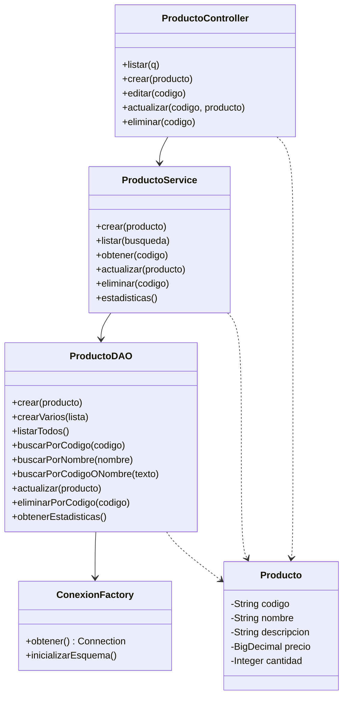
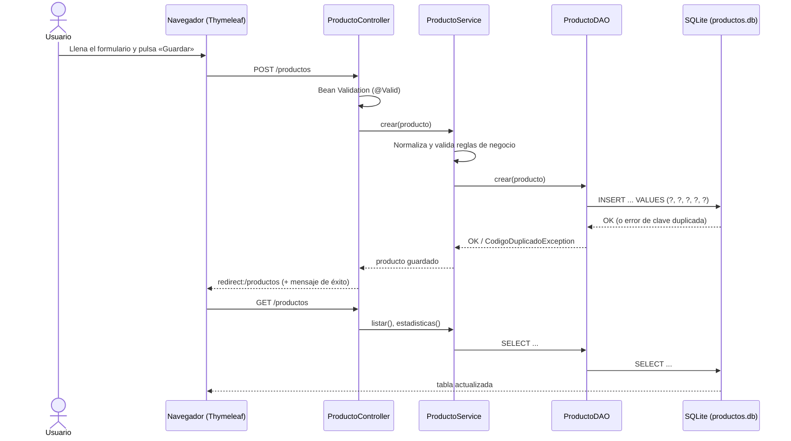

# Sistema de Gestión de Productos

Aplicación web para administrar el inventario de un pequeño establecimiento comercial. Permite **registrar, consultar, buscar, actualizar y eliminar** productos (CRUD). Los datos se guardan en un archivo **SQLite** (`productos.db`) usando **JDBC** con `PreparedStatement`, por lo que siguen ahí después de cerrar y reiniciar el programa.

> **Estado de verificación (léelo antes de entregar):**
> - ✅ Ejecutado de verdad: las **28 pruebas** de `ProductoDAOTest` y `ProductoServiceTest` (JDBC + SQLite real + reglas de negocio) pasaron en el entorno donde se generó el proyecto, usando el driver `sqlite-jdbc 3.46.1.3` y un ejecutor mínimo compatible con la API de JUnit (ese entorno no podía descargar Maven Central).
> - ⚠️ **No ejecutado allí:** `mvn clean test` / `mvn package`, el arranque de Spring Boot, las plantillas Thymeleaf, el `ProductoControllerIntegrationTest` y la imagen Docker. El código está escrito para compilar, pero **debes ejecutar `mvn clean test` en tu computador** y corregir lo que aparezca antes de entregar. Más abajo hay una lista de comprobación.

---

## 1. Tecnologías

| Capa | Tecnología |
|---|---|
| Lenguaje | Java 21 (LTS) |
| Framework web | Spring Boot 3.3.x, Spring MVC |
| Vistas | Thymeleaf, HTML5, CSS3, JavaScript, Bootstrap 5 (CDN) |
| Acceso a datos | **JDBC puro** (`Connection`, `PreparedStatement`, `ResultSet`) — sin JPA |
| Base de datos | SQLite (driver `org.xerial:sqlite-jdbc`) |
| Validación | Bean Validation (`jakarta.validation`) + validación en el servicio |
| Pruebas | JUnit 5, Spring Boot Test, MockMvc |
| Build | Maven |
| Despliegue | Docker, Render (demo gratuita) |

## 2. Estructura del proyecto

```
gestion-productos/
├── pom.xml
├── Dockerfile · .dockerignore · render.yaml · .gitignore
├── README.md
├── docs/GUION_VIDEO.md
└── src/
    ├── main/
    │   ├── java/com/gestionproductos/
    │   │   ├── GestionProductosApplication.java
    │   │   ├── model/       Producto.java · EstadisticasInventario.java
    │   │   ├── dao/         ProductoDAO.java
    │   │   ├── service/     ProductoService.java
    │   │   ├── controller/  ProductoController.java · ManejadorErrores.java
    │   │   ├── config/      ConexionFactory.java · DatabaseConfig.java
    │   │   └── exception/   AccesoDatos… · CodigoDuplicado… · ProductoNoEncontrado… · Validacion…
    │   └── resources/
    │       ├── application.properties · messages.properties · schema.sql
    │       ├── templates/   fragments.html · productos.html · producto-form.html · error.html
    │       └── static/      css/styles.css · js/app.js
    └── test/java/com/gestionproductos/
        ├── dao/ProductoDAOTest.java
        ├── service/ProductoServiceTest.java
        └── controller/ProductoControllerIntegrationTest.java
```

## 3. Modelo de datos

```sql
CREATE TABLE IF NOT EXISTS productos (
    codigo      TEXT    PRIMARY KEY NOT NULL CHECK (length(trim(codigo)) > 0),
    nombre      TEXT    NOT NULL CHECK (length(trim(nombre)) > 0),
    descripcion TEXT    NOT NULL DEFAULT '',
    precio      REAL    NOT NULL CHECK (precio >= 0),
    cantidad    INTEGER NOT NULL CHECK (cantidad >= 0)
);
```

El script está en `src/main/resources/schema.sql`. `DatabaseConfig` lo ejecuta al arrancar (a través de `ConexionFactory.inicializarEsquema()`); como usa `IF NOT EXISTS`, **nunca borra ni recrea** una tabla con datos. Las restricciones `PRIMARY KEY` y `CHECK` hacen que la propia base de datos rechace códigos repetidos, precios negativos y cantidades negativas aunque falle la validación de la aplicación.

**Notas de diseño**
- El código se normaliza a MAYÚSCULAS y sin espacios (`p1` y `P1` son el mismo producto).
- `precio` se guarda como `REAL` y se maneja en Java como `BigDecimal` con 2 decimales. Para un taller es suficiente; en un sistema contable real se guardaría en centavos (entero).
- **Valor del inventario** = Σ (precio × cantidad). Es una *estimación*, no una valoración contable.
- La búsqueda es insensible a mayúsculas para caracteres ASCII; SQLite no ignora mayúsculas en letras acentuadas (p. ej. `Ñ` vs `ñ`).

## 4. Arquitectura





### Responsabilidades

| Componente | Responsabilidad | Lo que NO hace |
|---|---|---|
| **Modelo** (`Producto`) | Representa los datos y declara sus restricciones de validación. | No accede a la base de datos. |
| **DAO** (`ProductoDAO`) | Único lugar con SQL/JDBC. Traduce filas ⇄ objetos y `SQLException` ⇄ excepciones propias. | No contiene reglas de negocio ni sabe de HTTP. |
| **Servicio** (`ProductoService`) | Reglas de negocio: normaliza, valida, decide qué excepción lanzar. | No escribe SQL ni conoce vistas. |
| **Controlador** (`ProductoController`) | Recibe peticiones HTTP, valida formularios, llama al servicio y elige la vista. | No contiene SQL ni cálculos de negocio. |
| **Config** (`ConexionFactory`, `DatabaseConfig`) | Ruta del archivo, creación del esquema, datos de ejemplo. | — |

## 5. JDBC y `PreparedStatement`

**JDBC** (Java Database Connectivity) es la API estándar de Java para hablar con bases de datos relacionales. El flujo es siempre el mismo:

1. Obtener una `Connection` (`DriverManager.getConnection("jdbc:sqlite:ruta/productos.db")`).
2. Preparar una sentencia (`PreparedStatement`).
3. Asignar parámetros y ejecutar (`executeUpdate()` / `executeQuery()`).
4. Leer el `ResultSet` fila por fila.
5. Cerrar todo: aquí con **try-with-resources**, que cierra los recursos aunque haya excepciones.

```java
try (Connection c = conexiones.obtener();
     PreparedStatement ps = c.prepareStatement(
         "SELECT codigo, nombre, descripcion, precio, cantidad FROM productos WHERE codigo = ?")) {
    ps.setString(1, codigo);          // el valor viaja como DATO, no como parte del SQL
    try (ResultSet rs = ps.executeQuery()) { ... }
}
```

**Por qué `PreparedStatement`:** el SQL con `?` se compila aparte de los valores. Si alguien escribe `' OR '1'='1` como código, la base de datos lo trata como un texto cualquiera, no como SQL. Eso evita la **inyección SQL**. Nunca se concatenan valores del usuario dentro de una consulta (las pruebas `resisteUnIntentoDeInyeccionSql` y `unCodigoMalFormadoNoEliminaNada` lo comprueban).

**Transacciones:** `crearVarios` desactiva el auto-commit, inserta varios productos y hace `commit()`; si uno falla, `rollback()` y no queda ninguno (prueba `laTransaccionRevierteTodoSiUnaInsercionFalla`).

**Seguridad y errores**
- Los errores SQL se traducen a excepciones propias con mensajes claros; el detalle técnico solo va al log, nunca a la pantalla.
- Thymeleaf escapa el HTML (`th:text`), lo que previene XSS (prueba `escapaElContenidoHtmlParaEvitarXss`).
- No se usa Spring Security, así que **no hay protección CSRF ni autenticación**: es un taller con un solo usuario. Si se publicara de verdad, habría que añadirlas.
- No hay contraseñas ni secretos en el repositorio.

## 6. Requisitos

- **JDK 21** (`java -version`) — [Temurin](https://adoptium.net/) es gratuito.
- **Maven 3.9+** (`mvn -v`).
- Navegador web. Los estilos usan Bootstrap desde una CDN, así que necesitas Internet para ver el diseño completo (sin Internet la aplicación funciona, pero sin estilos).
- Opcional: Docker.

## 7. Ejecución local

```bash
git clone <URL-DE-TU-REPOSITORIO> gestion-productos
cd gestion-productos

mvn clean test                       # 1. compilar y ejecutar las pruebas
mvn clean package                    # 2. generar target/gestion-productos.jar
java -jar target/gestion-productos.jar   # 3. iniciar la aplicación
```

Abre <http://localhost:8080>. Para detenerla pulsa `Ctrl + C`; para reiniciarla vuelve a ejecutar el último comando.

**Ruta de la base de datos:** por defecto `./data/productos.db` (relativa a la carpeta desde donde ejecutas el comando; se crea sola). Para cambiarla:

```bash
# Linux / macOS
DB_PATH=/ruta/segura/productos.db java -jar target/gestion-productos.jar
# Windows PowerShell
$env:DB_PATH="C:\datos\productos.db"; java -jar target\gestion-productos.jar
```

Si el archivo ya existe, **no se borra ni se sobrescribe**. Los datos de ejemplo (4 productos) solo se insertan cuando el archivo se crea por primera vez; para no tenerlos usa `APP_SEED=false`.

### Comprobar la persistencia (para el video)
1. Inicia la aplicación y registra un producto nuevo.
2. Detén la aplicación (`Ctrl + C`) y confirma que existe `data/productos.db`.
3. Vuelve a iniciarla: el producto sigue en la tabla.

### Con Docker (opcional)
```bash
docker build -t gestion-productos .
docker run -d --name gp -p 8080:8080 -v gp-datos:/data gestion-productos
docker stop gp          # detener
docker start gp         # reiniciar: los datos siguen porque están en el volumen gp-datos
```
Sin el parámetro `-v gp-datos:/data`, los datos se pierden al eliminar el contenedor.

## 8. Pruebas

```bash
mvn clean test
```

| Prueba | Qué comprueba |
|---|---|
| `ProductoDAOTest` (15) | Creación del directorio y la tabla; que reinicializar no borra datos; crear/consultar; código duplicado; búsqueda por código y nombre; comodines `%`/`_` literales; inyección SQL; actualizar; eliminar; inexistentes; CHECK de precio/cantidad negativos en la propia BD; transacción con rollback; estadísticas; **persistencia tras cerrar y reabrir**. |
| `ProductoServiceTest` (13) | Normalización; duplicados sin importar mayúsculas; precio y cantidad negativos; campos obligatorios vacíos; códigos con caracteres peligrosos; listar y buscar; actualizar/consultar/eliminar inexistentes; eliminar con código inválido. |
| `ProductoControllerIntegrationTest` (10) | Flujo HTTP completo con Spring Boot + SQLite temporal: registrar, duplicado, validaciones, editar, eliminar, buscar, estado vacío, escape XSS. |

Todas las pruebas usan un archivo SQLite **temporal**; nunca tocan tu `productos.db` real.

> Resultado real obtenido al generar el proyecto: **28 de 28** pruebas del DAO y del servicio correctas (ejecutor mínimo compatible con JUnit). El resultado de `mvn clean test` completo, incluidas las 10 pruebas de integración, **lo debes obtener tú** y capturarlo como evidencia.

## 9. Despliegue público gratuito (y su limitación real)

Plataforma elegida: **Render** (servicio web con Docker). Condiciones verificadas en la documentación oficial de Render (docs.render.com, consultada el 25 de octubre de 2026; vuelve a revisarlas antes de entregar porque pueden cambiar):

- Los servicios de Render tienen sistema de archivos **efímero**: los cambios locales se pierden en cada reinicio o nuevo despliegue.
- Los **discos persistentes solo se pueden adjuntar a servicios de pago**; los servicios gratuitos no pueden.
- Un servicio web gratuito se **suspende tras 15 minutos sin tráfico** (la primera visita después tarda en responder), recibe **750 horas gratuitas al mes** por espacio de trabajo y **Render puede reiniciarlo en cualquier momento**.

### ⚠️ Consecuencia para este proyecto
En el plan gratuito de Render **SQLite NO conserva los datos**: el archivo `productos.db` desaparece cuando el servicio se reinicia o se redespliega. Por eso hay dos modalidades que no se deben confundir:

| Modalidad | ¿Persiste SQLite? |
|---|---|
| **Local** (JAR o Docker con volumen) | ✅ Sí. |
| **Render gratuito** | ❌ No. Es una demostración: los datos pueden perderse en cualquier momento. |

### Opciones
1. **Demostración gratuita (recomendada para el taller):** publicar en Render gratis y decir expresamente al profesor que los datos son temporales. Sirve para que vea la interfaz y el CRUD funcionando.
2. **Persistencia real en la nube:** un plan de pago de Render con disco persistente (descomenta el bloque `disk:` de `render.yaml`; consulta el precio vigente en render.com/pricing) **o** otro proveedor con volumen persistente. No verifiqué otros proveedores, así que revisa sus condiciones actuales antes de contar con ellos.
3. **Mantener SQLite local** y mostrar la persistencia en el video con el programa en tu computador.

No cambié SQLite por otra base de datos: sigue siendo la implementación del taller.

### Pasos en Render (demo gratuita)
1. Sube el proyecto a GitHub (ver sección 10).
2. Crea una cuenta en <https://render.com> (puedes registrarte con tu cuenta de GitHub).
3. En el panel: **New → Blueprint**, conecta tu repositorio de GitHub y selecciona el repositorio. Render lee `render.yaml` (tipo `web`, `runtime: docker`, `plan: free`). *(Alternativa manual: New → Web Service → repositorio → Language: Docker → Instance type: Free.)*
4. Variables de entorno (ya declaradas en `render.yaml`): `DB_PATH=/data/productos.db`, `APP_SEED=true`. Render proporciona `PORT` automáticamente y la aplicación ya lo lee (`server.port=${PORT:8080}`).
5. Pulsa **Apply / Create** y espera el despliegue; la URL pública aparece en el panel del servicio (algo como `https://<nombre>.onrender.com`; **la URL real la asigna Render**, no la conozco de antemano).
6. Comprobación: abre la URL (la primera carga puede tardar si el servicio estaba dormido), registra un producto y verifica que aparece en la tabla.
7. Verificación de persistencia: en el panel pulsa **Manual Deploy → Restart** (o espera a que se duerma) y vuelve a abrir la URL. En el plan gratuito verás que el producto **ya no está** (solo los 4 de ejemplo): eso demuestra la limitación. Con un disco persistente en `/data` sí debería conservarse; **no lo he probado**.

> Si activas un disco persistente y la aplicación no puede escribir en `/data` (error de permisos), prueba a quitar la línea `USER appuser` del `Dockerfile`. No lo pude verificar sin una cuenta de Render.

## 10. Publicar en GitHub

```bash
cd gestion-productos
git init
git add .
git commit -m "Sistema de Gestión de Productos: CRUD con Java, JDBC y SQLite"
git branch -M main
git remote add origin https://github.com/<tu-usuario>/gestion-productos.git
git push -u origin main
```
(Antes crea el repositorio vacío en github.com → New repository.) El `.gitignore` ya excluye `target/` y los archivos `*.db`.

## 11. Evidencias que debes capturar
1. `mvn clean test` terminando en **BUILD SUCCESS** con el conteo de pruebas.
2. `mvn clean package` y el archivo `target/gestion-productos.jar`.
3. La aplicación en el navegador (panel completo con tarjetas y tabla).
4. Registro de un producto con mensaje de éxito.
5. Error de código duplicado y error de precio negativo.
6. Búsqueda por código y por nombre; estado vacío.
7. Edición de un producto.
8. Ventana de confirmación y eliminación.
9. Producto con «Inventario bajo» y con «Sin existencias».
10. El archivo `data/productos.db` en la carpeta y (opcional) su contenido con `sqlite3 data/productos.db "SELECT * FROM productos;"`.
11. Persistencia: aplicación detenida, vuelta a iniciar y datos intactos.
12. Código del DAO mostrando `PreparedStatement` y `try-with-resources`.
13. Repositorio en GitHub y, si lo despliegas, la URL pública con la advertencia de persistencia.

## 12. Preguntas que podría hacer el profesor

**¿Qué es JDBC?** Es la API estándar de Java (`java.sql`) para conectarse a bases de datos relacionales, enviar SQL y leer resultados. Cada base de datos aporta un *driver*; aquí es `sqlite-jdbc`.

**¿Por qué `PreparedStatement` y no `Statement`?** Porque separa el SQL de los datos: los `?` se rellenan con `setString`, `setInt`, etc. Evita la inyección SQL y la base de datos puede reutilizar la sentencia compilada.

**¿Qué pasa si escribo `' OR '1'='1` en el buscador o en el código?** Se trata como texto. La búsqueda no devuelve nada y la eliminación con ese código no borra nada (hay pruebas para ambos casos).

**¿Qué es el patrón DAO y por qué se usa?** *Data Access Object*: una clase que concentra todo el acceso a datos. Así el resto de la aplicación no sabe si los datos están en SQLite, en otra base o en un archivo; si cambia el almacenamiento, solo cambia el DAO.

**¿Por qué separar DAO, servicio y controlador?** Cada capa tiene una sola responsabilidad: el DAO guarda, el servicio decide (reglas), el controlador atiende la web. Es más fácil de probar y de mantener.

**¿Qué es CRUD?** *Create, Read, Update, Delete*: crear, consultar, actualizar y eliminar. Corresponden a `INSERT`, `SELECT`, `UPDATE` y `DELETE`.

**¿Cómo se garantiza que el código sea único?** Con `PRIMARY KEY` en la tabla. Si se repite, SQLite lanza «UNIQUE constraint failed» y el DAO lo convierte en `CodigoDuplicadoException`, que el usuario ve como un mensaje claro. No depende solo de una consulta previa (que podría fallar si dos usuarios guardan a la vez).

**¿Dónde se valida?** En tres niveles: HTML5 en el navegador (comodidad), Bean Validation + servicio en el servidor (obligatorio, porque el cliente se puede saltar), y restricciones `CHECK`/`PRIMARY KEY` en la base de datos (última barrera).

**¿Cómo se logra la persistencia?** SQLite escribe en un archivo (`productos.db`) en disco. Al reiniciar, la aplicación abre ese mismo archivo; `CREATE TABLE IF NOT EXISTS` no borra nada. La prueba `losDatosPersistenAlCerrarYVolverAAbrirLasConexiones` lo comprueba.

**¿Por qué no hay persistencia en el despliegue gratuito?** Porque el plan gratuito de Render usa un sistema de archivos efímero y no admite discos persistentes. El archivo SQLite vive en ese sistema de archivos, así que se pierde al reiniciar. Para conservarlo hace falta un disco persistente (plan de pago) u otra estrategia.

**¿Para qué sirve `try-with-resources`?** Cierra automáticamente `Connection`, `PreparedStatement` y `ResultSet`, incluso si ocurre una excepción, evitando fugas de conexiones.

**¿Qué es una transacción y dónde se usa?** Un conjunto de operaciones que se confirman juntas (`commit`) o se deshacen juntas (`rollback`). Se usa al insertar los datos de ejemplo: si falla uno, no se guarda ninguno.

**¿Es segura la aplicación?** Previene inyección SQL y XSS, y valida entradas, pero no tiene login ni protección CSRF; es un taller de un solo usuario.

## 13. Lista de comprobación final

- [ ] `mvn clean test` → BUILD SUCCESS (anota cuántas pruebas pasaron).
- [ ] La aplicación arranca y el CRUD funciona en el navegador.
- [ ] Persistencia comprobada deteniendo y reiniciando.
- [ ] Capturas de la sección 11 guardadas.
- [ ] Repositorio en GitHub sin `target/` ni `*.db`.
- [ ] Si publicas en Render: la advertencia de persistencia incluida en la entrega y en el video.
- [ ] Guion en inglés ensayado (`docs/GUION_VIDEO.md`).
- [ ] Documento técnico APA / cualquier otro requisito del taller que no cubre este repositorio.
# gestion-productos
